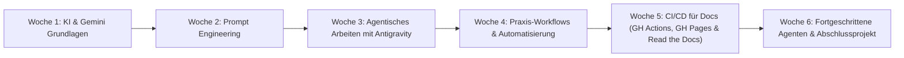

# Lernplan: KI erlernen mit Antigravity + Gemini

Dieser Lernplan richtet sich an eine **gemischte Gruppe (Einsteiger bis Fortgeschrittene)**: Er bleibt praxisnah ohne tiefe Programmier-Voraussetzungen, bietet aber in jedem Modul einen optionalen **technischen Ausblick** für Fortgeschrittene.

- **Format:** 6-Wochen-Programm (ca. 3–4 Std./Woche, 1 Modul pro Woche) – alternativ als **2-Tages-Intensivkurs** (Tag 1: Module 1–3, Tag 2: Module 4–6).
- **Besonderheit:** Enthält ein eigenständiges Praxis-Modul (Modul 5) zur automatisierten Veröffentlichung von Dokumentation über **GitHub Actions**, **GitHub Pages** und **Read the Docs**.

---

## Lernpfad im Überblick

---

## Modul 1 (Woche 1): Grundlagen der Generativen KI & Gemini

**Zeitbedarf:** ca. 3 Std. | **Details:** [`module/01-grundlagen-ki-gemini/README.md`](./module/01-grundlagen-ki-gemini/README.md)

- **Lernziel:** Verstehen, wie LLMs funktionieren, wann welches Gemini-Modell passt und wie man KI sicher und kritisch einsetzt.
- **Schwerpunkte:** Token, Kontextfenster, Halluzinationen, Gemini *Flash* vs. *Pro*, Multimodalität, Datenschutz & Faktencheck.
- **Praxis:** Dokument analysieren & kritisch prüfen (*Technischer Ausblick:* JSON-Ausgaben & systematischer Modellvergleich).

---

## Modul 2 (Woche 2): Prompt Engineering & Strukturierte Zusammenarbeit

**Zeitbedarf:** ca. 3 Std. | **Details:** [`module/02-prompt-engineering/README.md`](./module/02-prompt-engineering/README.md)

- **Lernziel:** Verlässliche, wiederverwendbare und präzise Ergebnisse mit Gemini erzielen.
- **Schwerpunkte:** Prompt-Anatomie, Few-Shot-Beispiele, schrittweises Zerlegen, iteratives Verfeinern, Review-Prompts, strukturierte Formate.
- **Praxis:** Persönliche Prompt-Sammlung aufbauen (*Technischer Ausblick:* Prompt-Versionierung in Git).

---

## Modul 3 (Woche 3): Einstieg in Agentisches Arbeiten mit Antigravity

**Zeitbedarf:** ca. 3–4 Std. | **Details:** [`module/03-antigravity-einstieg/README.md`](./module/03-antigravity-einstieg/README.md)

- **Lernziel:** Vom reinen Chatten zum strukturierten Delegieren an einen KI-Agenten wechseln.
- **Schwerpunkte:** Chatbot vs. Agent, Workspaces & GitHub-Integration, Artefakte, effektives Briefing, Human-in-the-Loop Reviews.
- **Praxis:** Erste Projekt-/Wissensseite mit Antigravity im Repository anlegen und im Review verbessern (*Technischer Ausblick:* Branches & Pull Requests).

---

## Modul 4 (Woche 4): Praxis-Workflows, Automatisierung & Multimodalität

**Zeitbedarf:** ca. 3–4 Std. | **Details:** [`module/04-praxis-workflows/README.md`](./module/04-praxis-workflows/README.md)

- **Lernziel:** Wiederkehrende Aufgaben aus Wissensarbeit, Prototypenbau und Automatisierung Ende-zu-Ende umsetzen.
- **Schwerpunkte:** Dokumentation & Diagramme (Mermaid), kleine Hilfstools & Prototypen, multimodale Eingaben (Screenshots/Skizzen), Qualitätssicherung.
- **Praxis:** Reales Alltagsproblem mit Antigravity lösen (*Technischer Ausblick:* Automatisierte Tests & strukturiertes Debugging).

---

## Modul 5 (Woche 5): CI/CD-Pipelines für Dokumentation (GitHub Actions, GitHub Pages & Read the Docs)

**Zeitbedarf:** ca. 4 Std. | **Details:** [`module/05-cicd-docs-ghpages-readthedocs/README.md`](./module/05-cicd-docs-ghpages-readthedocs/README.md)

- **Lernziel:** Verstehen, wie Dokumentation tool-agnostisch automatisiert geprüft und über **GitHub Pages** sowie **Read the Docs** veröffentlicht wird.
- **Schwerpunkte:** Docs-as-Code, GitHub Actions Grundlagen, Vergleich GitHub Pages vs. Read the Docs, Beispiel-Workflows, Debugging mit Antigravity.
- **Praxis:** Beispiel-Workflows aus [`examples/ci-cd-docs/`](./examples/ci-cd-docs/README.md) verstehen und eine eigene statische Doku-Seite deployen (*Technischer Ausblick:* PR-Link-Checks + parallele `.readthedocs.yaml`-Anbindung).

---

## Modul 6 (Woche 6): Fortgeschrittene Agenten-Techniken & Abschlussprojekt

**Zeitbedarf:** ca. 4 Std. | **Details:** [`module/06-fortgeschrittene-agenten-abschlussprojekt/README.md`](./module/06-fortgeschrittene-agenten-abschlussprojekt/README.md)

- **Lernziel:** Komplexe Vorhaben strukturiert planen, wiederholbare Standards etablieren und ein eigenes Abschlussprojekt umsetzen.
- **Schwerpunkte:** Kontext-Management, Planungs-Workflows (`/plan`, `/grill-me`), Skills, Subagenten, Capstone-Projekt & Transfer in den Alltag.

---

## Erfolgskriterien

- [ ] Kann erklären, wann Gemini (Chat) und wann Antigravity (Agent) die richtige Wahl ist.
- [ ] Kann präzise Prompts und klare Agenten-Briefings formulieren.
- [ ] Kann eine Docs-as-Code CI/CD-Pipeline mit GitHub Actions, GitHub Pages und Read the Docs einordnen und mit Antigravity konfigurieren bzw. debuggen.
- [ ] Hat ein eigenes Praxisprojekt von der Idee bis zur überprüften Umsetzung abgeschlossen.
