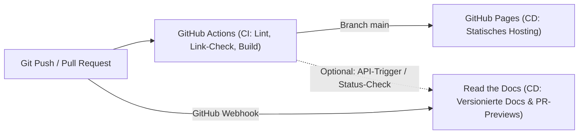

# Modul 5: CI/CD-Pipelines für Dokumentation (GitHub Actions, GitHub Pages & Read the Docs)

- **Zeitbedarf:** ca. 4 Std. (Woche 5)
- **Beispiel-Workflows:** [`examples/ci-cd-docs/`](../../examples/ci-cd-docs/README.md)

## Lernziele
- Das Prinzip **Docs-as-Code** und den Unterschied zwischen **CI** (Prüfen/Bauen) und **CD** (Veröffentlichen) verstehen.
- Den Aufbau einer **GitHub Actions**-Pipeline lesen, anpassen und mit Antigravity debuggen können.
- **GitHub Pages** und **Read the Docs** fundiert vergleichen und wissen, wann welche Plattform (oder eine Kombination) passt.
- Tool-agnostisch verstehen, wie statische Seiten und Docs-Generatoren (z. B. MkDocs, Sphinx, Docusaurus, plain HTML) in dieselbe CI/CD-Kette passen.

---

## Pipeline-Architektur im Überblick

---

## Vergleich: GitHub Pages vs. Read the Docs

| Kriterium | GitHub Pages | Read the Docs |
| --- | --- | --- |
| **Stärke** | Direkt in GitHub integriert, sehr flexibel (Docs, Landingpages, kleine Web-Apps) | Spezialisiert auf technische Dokumentation |
| **Versionierung** | Manuell / über eigene Workflow-Logik | Eingebaut (`latest`, `stable`, Tags & Branches) |
| **PR-Vorschauen** | Nur über Zusatz-Workflows | Out-of-the-box für Pull Requests |
| **Suche & Export** | Abhängig vom gewählten Generator | Eingebaute Suche, PDF/ePub-Export |
| **Konfiguration** | `.github/workflows/pages.yml` | `.readthedocs.yaml` (+ optional GH Actions CI) |

---

## Themen
1. **Docs-as-Code & CI/CD-Grundlagen** – Warum Dokumentation wie Code versioniert, geprüft und automatisch veröffentlicht wird.
2. **GitHub Actions lesen & verstehen** – `on` (Trigger), `permissions`, `jobs`, `steps`, Artefakte, Secrets.
3. **GitHub Pages Deployment** – Offizielle Actions (`configure-pages`, `upload-pages-artifact`, `deploy-pages`) und Deployment-Schutzregeln.
4. **Read the Docs Integration** – Aufbau von `.readthedocs.yaml`, automatische Builds per Webhook, optionale Kombination mit GitHub Actions (z. B. Link-Check im PR + API-Trigger).
5. **Antigravity als CI/CD-Assistent** – Workflows erzeugen lassen, fehlerhafte Action-Logs analysieren und YAML-Probleme gezielt beheben.

---

## Übungen
- **Basis-Übung:** Die Beispiel-Dateien in [`examples/ci-cd-docs/`](../../examples/ci-cd-docs/README.md) mit Antigravity durchgehen, jede Sektion erklären lassen und ein einfaches statisches Beispiel über GitHub Pages veröffentlichen.
- **Technischer Ausblick:** Einen PR-Check-Workflow (Build + Link-Check) aktivieren und parallel eine `.readthedocs.yaml` für ein eigenes Doku-Projekt anbinden.

## Checkliste
- [ ] Unterschied zwischen CI und CD am Beispiel Dokumentation erklärt
- [ ] Vor- und Nachteile von GitHub Pages vs. Read the Docs eingeordnet
- [ ] Beispiel-Workflow für GitHub Pages und `.readthedocs.yaml` nachvollzogen
- [ ] Einen Workflow-Fehler (absichtlich eingebaut) mit Antigravity analysiert und behoben
